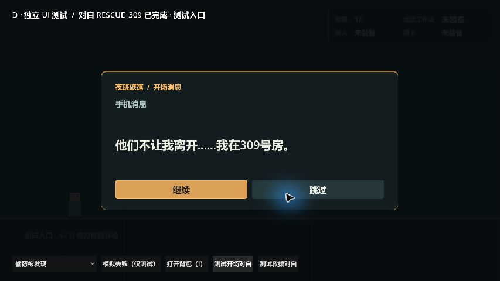
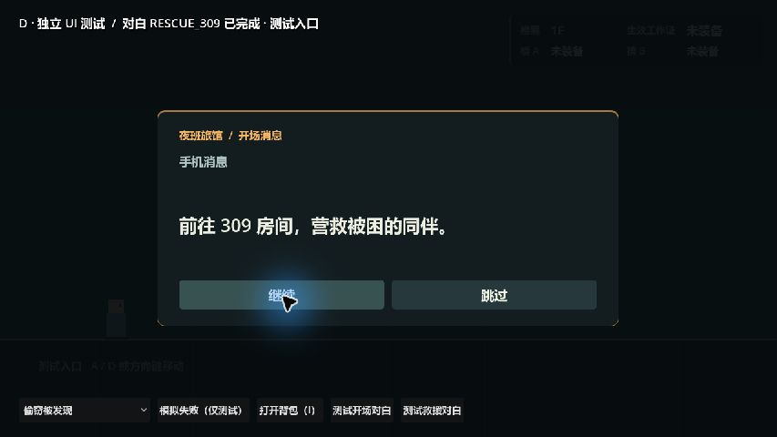
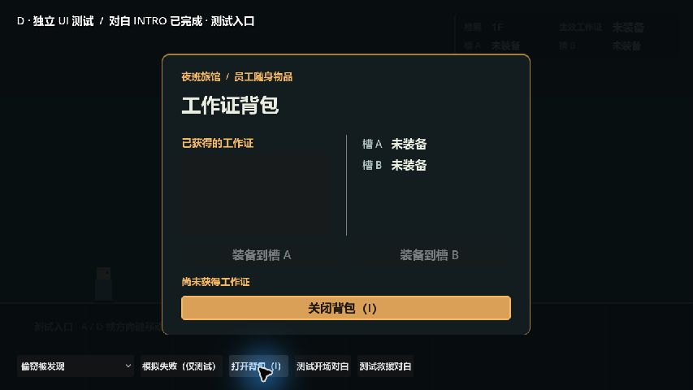
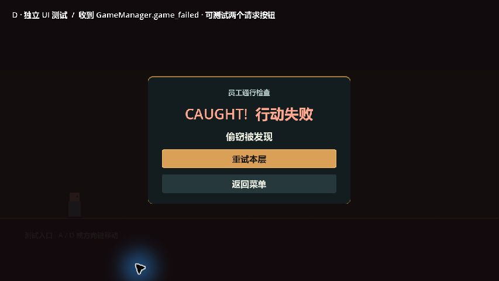

# 玩家操作说明（当前开发版）

本说明依据项目已确认的输入映射和玩法规则编写。当前完整的 1F→5F 流程尚未接入主场景；表中“计划流程”用于说明目标玩法，不表示当前 F5 已可通关。D 的菜单、图鉴、HUD、背包、对白、失败页和通关页在个人分支的独立 UI 测试场景中验证。

## 如何打开

1. 用 Godot 4.7.2 导入仓库根目录的 `project.godot`。
2. F5 运行 `scenes/main.tscn` 可查看当前公共测试走廊。
3. 要体验 D 的独立界面测试，在文件系统中打开 `scenes/tests/ui/ui_test.tscn`，按 F6。该场景用于检查 UI，不会模拟完整的楼层通关。

## 操作按键

| 按键 | 操作 | 当前接入情况 |
|---|---|---|
| A／左方向键 | 向左移动 | 主角和公共测试走廊可用 |
| D／右方向键 | 向右移动 | 主角和公共测试走廊可用 |
| E | 交互：背后偷取工作证、309 救援或使用出口 | 员工组件有独立交互；救援和出口流程待 A 接入主流程。偷取按住约 0.8 秒为策划原型值 |
| Q | 切换当前生效的佩戴槽 | 由 CardManager 处理；具体玩法以卡片模块实测为准 |
| I | 打开／关闭工作证背包 | D 的独立 UI 测试场景可用；主场景接入待 A |
| H | 打开／关闭操作说明与图鉴 | D 的独立 UI 测试场景可用；主场景接入待 A |
| Esc | 暂停／菜单 | 暂停期间 UI 与门计时行为尚待确认，不作为当前已验证操作 |

按键名称与绑定以 `project.godot` 的 InputMap 为准。

## 计划中的旅馆路线

1. 在 1F 从三名员工背后取得 `SECURITY`、`CLEANER`、`MANAGER` 三张工作证。最多佩戴两张，Q 切换当前生效的卡。
2. 从 2F 到 5F 观察房门状态，再按对应怪物规则通过。只有房门 `OPEN` 且主角在该门检测范围内时才检查怪物规则；`CLOSED` 和 `WARNING` 时不触发这些失败判定。
3. 在 3F 的 309 救出闺蜜，再前往 5F 的 EXIT。具体开场、楼层连接、救援状态、跟随、重试和出口流程仍需 A 接入与验收。

## 工作证与怪物规则

| 怪物 ID | 安全条件 | 失败原因 |
|---|---|---|
| `EYE`（独眼客） | 当前工作证为 `SECURITY`，或等门关闭 | `WRONG_CARD` |
| `NOSE`（长鼻客） | 当前工作证为 `CLEANER`，或等门关闭 | `WRONG_CARD` |
| `HAT`（礼帽客） | 当前工作证为 `MANAGER`，或等门关闭 | `WRONG_CARD` |
| `EAR`（大耳客） | 在检测范围内停下并等门关闭；工作证不影响判定 | 移动时为 `MOVED_NEAR_EAR` |
| `CHECKER`（核验客） | 提前选好工作证；在门前不切卡或更换佩戴槽 | 在检测范围内换证时为 `SWITCHED_NEAR_CHECKER` |

员工发现偷窃时的失败原因是 `STAFF_CAUGHT`。失败界面提供重试和返回菜单请求；这些请求需要由 A 连接到实际游戏流程。

上表是已确认的设计规则。当前 C 门组件只完成独眼客判定；其余四种怪物规则尚未全部接入正式楼层，详细房号见[房号与怪物表](room-monster-table.md)。

## D 界面截图

以下截图来自 Godot 4.7.2 的 `ui_test.tscn` 独立测试运行画面，显示的是 D 的组件及测试入口，不是完整主线或正式发行画面。

四张图依次展示 INTRO 求救信息、前往 309 的目标、背包空状态和失败提示；文件均在 `docs/media/`。完整演示尚未录制，后续录制顺序及接入依赖见[演示录制清单](demo-recording-checklist.md)。

## 交付状态

- 操作说明和 D 界面截图已整理在本分支工作区。
- 完整 1—3 分钟项目演示视频：待 A 将主线接入并确定全流程可录制版本后制作，避免把独立 UI 测试误称为完整游戏演示。
- 四人中文姓名：D（蔡至纯）已由本人确认；A、B、C 的姓名待 A 核实后补齐。
- Windows 完整通关、跨电脑试玩、导出包和 T01—T14 主线验收仍待完成。
