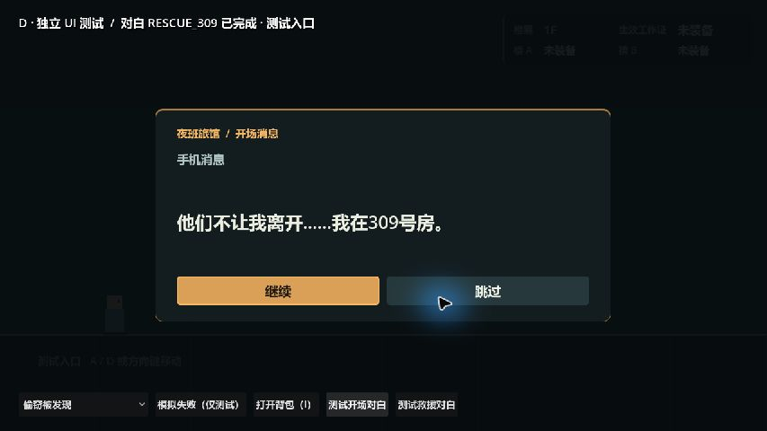
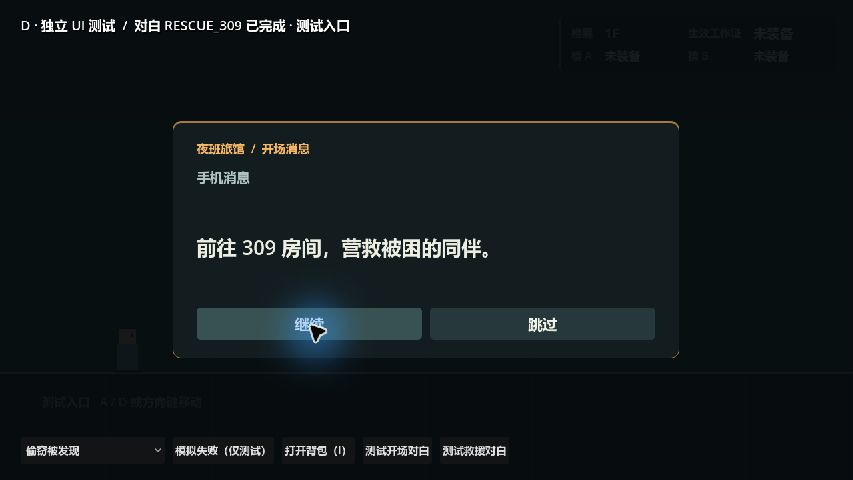
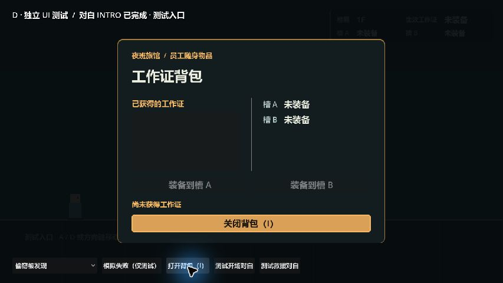
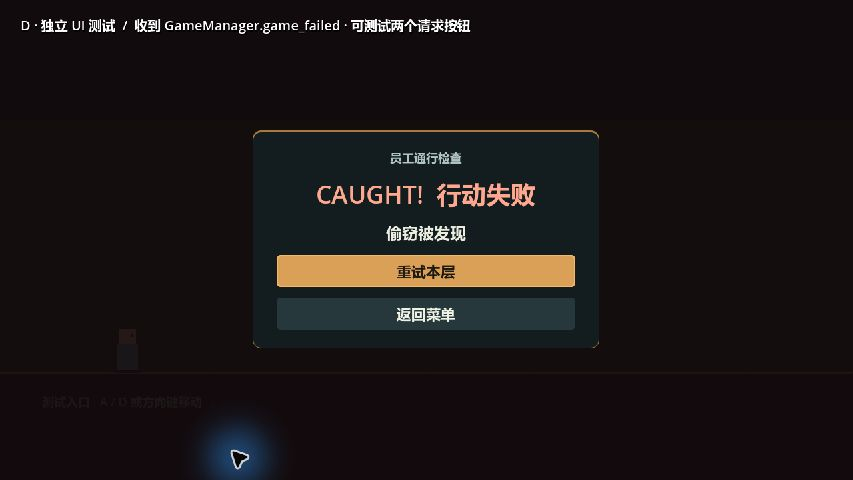

# 玩家操作说明（V4 开发版）

当前 F5 可体验序章、1F 前台经理对白、上 2F 与 201 任务的已接入部分。任务 02—05、完整的 309 救援与结局仍待主线联调；任务 01 已接入检查点重试。

## 如何打开

1. 用 Godot 4.7.2 导入仓库根目录的 `project.godot`。
2. 按 F5 运行 `scenes/main.tscn`。点击「开始游戏」，用 E 或鼠标左键推进序章，进入一楼后走到前台，按 E 与经理交谈。
3. 经理对白结束后到右端楼梯按 E，选择 2F。上楼无需事先拿到工作证。
4. 要查看独立界面，打开 `scenes/tests/ui/ui_test.tscn` 并按 F6。可在这里独立检查任务面板、楼层选择、警告、失败及通关页。

## 操作按键

| 按键 | 操作 |
|---|---|
| A／D 或左右方向键 | 左右移动 |
| E／鼠标左键 | 推进对白 |
| E | 与前台经理对话、使用楼梯或执行当前地点交互；偷取、清洁等长按操作按场景提示执行 |
| Q | 切换当前生效的工作证 |
| I | 背包内查看和装备工作证 |
| H | 查看说明与随进度解锁的调查笔记 |
| Esc | 打开或关闭暂停页 |

## 任务与工作证

| 任务 | 工作证来源 | 用途 |
|---|---|---|
| 01 · 2F 201 长鼻客 | 接受任务后可回 1F 保洁区取得 `CLEANER` | 清洁污渍，再回 201 交付 |
| 02 · 2F 202 独眼客 | 接受任务后可在 2F 员工值班点取得 `SECURITY` | 领取包裹，再回 202 交付 |
| 03 · 3F 303 礼帽客 | 接受任务后可回 1F 前台取得 `MANAGER` | 批准 309 登记 |

三张工作证最多同时佩戴两张，工作权限按当前生效的卡判断。V4 的后续路线是批准 309 登记、救出闺蜜，完成巡房表和离店手续后从五楼 EXIT 逃离。

## 房门规则

| 怪物 | 开门时在检测范围内的安全条件 | 违规原因 |
|---|---|---|
| 长鼻客 `NOSE`（201） | 使用 `CLEANER`，或等门关闭 | `WRONG_CARD` |
| 独眼客 `EYE`（202） | 使用 `SECURITY`，或等门关闭 | `WRONG_CARD` |
| 大耳客 `EAR`（203） | 停步等门关闭 | `MOVED_NEAR_EAR` |
| 核验客 `CHECKER`（204） | 提前选好卡，经过时不切卡或换装 | `SWITCHED_NEAR_CHECKER` |
| 礼帽客 `HAT`（205） | 使用 `MANAGER`，或等门关闭 | `WRONG_CARD` |

房号是 V4 目标配置，当前 202 仍处于 M1 普通门阶段，详见[房号与怪物表](room-monster-table.md)。普通门违规会警告并退回安全位置。员工抓到偷窃或任务超时属于任务失败，任务 01 的失败页可恢复到接受前的检查点，再次接受后才开始计时。没有可用检查点时，重试按钮禁用。

## D 界面截图

以下为旧版 D 独立 UI 测试的历史截图，来自 Godot 4.7.2。当前序章布局与 F6 测试入口已有更新。

四张图依次展示 INTRO 求救信息、前往 309 的目标、背包空状态和失败提示；文件均在 `docs/media/`。完整演示尚未录制，后续录制顺序及接入依赖见[演示录制清单](demo-recording-checklist.md)。

## 交付状态

- 操作说明和 D 界面截图已整理在本分支工作区。
- 完整 1—3 分钟项目演示视频：待 A 将主线接入并确定全流程可录制版本后制作，避免把独立 UI 测试误称为完整游戏演示。
- 四人中文姓名：D（蔡至纯）已由本人确认；A、B、C 的姓名待 A 核实后补齐。
- Windows 完整通关、跨电脑试玩、导出包和 V4 主线验收仍待完成。
